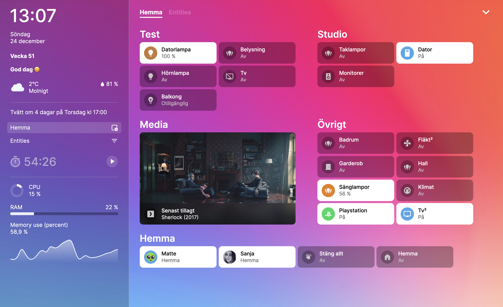

# Vortex UI

A Home Assistant dashboard that actually feels like home.

Home Assistant is one of the most powerful home automation platforms available, and also one of the least inviting to look at. Vortex UI is the layer between HA and your wall tablet: fast, configurable, and built by someone who uses it every day.

[](https://youtu.be/2jNCyvkyLD8)

---

## Why Vortex UI

**A dashboard that adapts to your home, not the other way around.**
The kitchen tile doesn't have to be a single light switch. It can be the camera outside the door, the button that opens the gate, and the sensor that tells you if it's raining — all in one place because that's what makes sense in your kitchen. The Custom Panel lets you compose exactly that: rows of cameras, buttons, sensors, and sliders inside a single tile, shaped around how you actually move through your space. Every room is different; the dashboard should reflect that.

**The simplest interface is sometimes no interface at all.**
Vortex UI includes a built-in AI assistant connected to whichever agent you've already configured in Home Assistant — Anthropic, Google, OpenAI, a local Ollama model, anything HA supports. Ask it something, get an answer or an action. Voice input and spoken responses work wherever the browser allows it. Nothing extra to set up: it routes through Home Assistant's conversation API and stays within the boundaries of what HA already knows about your home.

**Designed to run unattended.**
On a wall panel, the dashboard should mostly take care of itself. When the doorbell rings, the camera feed opens automatically and a countdown gives you time to unlock the door before the modal closes on its own. When nobody's been near the panel for a few minutes, it returns to whatever view you've set as the default — the floor plan, the living room, whatever makes sense as the idle state. No taps required, no stale screens left open.

---

## Installation

Vortex UI is a standalone web application. It can be installed with Docker or from the Home Assistant Add-on Store using the separately maintained add-on repository below.

### Home Assistant Add-on

[](https://my.home-assistant.io/redirect/supervisor_add_addon_repository/?repository_url=https%3A%2F%2Fgithub.com%2FxSaleGG%2Faddon-vortex-ui)

Or add `https://github.com/xSaleGG/addon-vortex-ui` manually in **Settings → Add-ons → Add-on Store → ⋮ → Repositories**.

The add-on can be installed after its first per-architecture images have been published and the GHCR packages have been made public.

### Docker

```bash
docker compose up -d vortex-ui
```

**Update:**

```bash
docker compose pull vortex-ui && docker compose up -d vortex-ui
```

<details>
<summary>Without Compose</summary>

```bash
docker run -d \
  --name vortex-ui \
  --network bridge \
  -p 5050:5050 \
  -v /path/to/data:/app/data \
  -e TZ=Europe/Rome \
  -e HASS_URL=http://your-ha-instance:8123 \
  --restart always \
  ghcr.io/xsalegg/vortex-ui
```

</details>

---

## Query strings

| Parameter     | Effect                                          |
| ------------- | ----------------------------------------------- |
| `?view=Name`  | Load a specific view on startup                 |
| `?menu=false` | Hide the menu button (useful on kiosk displays) |

---

## Keyboard shortcuts

| Key                    | Action       |
| ---------------------- | ------------ |
| `f`                    | Filter       |
| `Esc`                  | Exit / close |
| `Cmd/Ctrl + S`         | Save         |
| `Cmd/Ctrl + Z`         | Undo         |
| `Cmd/Ctrl + Shift + Z` | Redo         |

---

## Development

```bash
git clone https://github.com/xSaleGG/vortex-ui.git
cd vortex-ui
npm ci

cp .env.example .env   # set HASS_URL

npm run dev       # dev server with HA proxy
npm run check     # type check
npm run lint      # eslint + prettier
npm run format    # auto-fix formatting
```

Dashboard config: `data/dashboard.yaml` — App config: `data/configuration.yaml`

---

## Release

Update the version on a release branch, for example:

```bash
npm version 2026.11.1 --no-git-tag-version
```

Run `npm ci`, `npm run check`, and `npm run build`, then commit the version change and merge it to `main`. Create and publish a GitHub Release whose tag exactly matches the version in `package.json`; include release notes in the release body.

Publishing the release triggers two workflows:

- `.github/workflows/docker-publish.yml` builds the standalone image for supported architectures and publishes the version and `latest` tags to `ghcr.io/xsalegg/vortex-ui`.
- `.github/workflows/sync-addon-release.yml` copies the release tag and notes into the [add-on repository](https://github.com/xSaleGG/addon-vortex-ui). The resulting push to its `main` branch triggers the add-on image build, which uses the exact Vortex UI release tag.

For cross-repository synchronization, add an `ADDON_REPO_TOKEN` Actions repository secret. It must have Contents read/write access to `xSaleGG/addon-vortex-ui`, and its push must be allowed to update that repository's `main` branch.

---

## Debug

```bash
docker logs vortex-ui   # backend errors
# browser console for frontend
```
